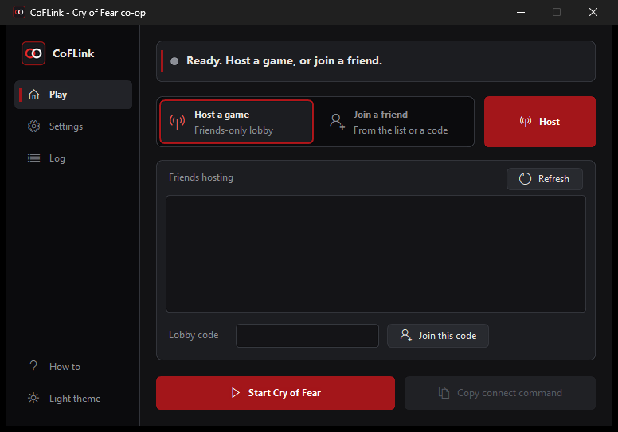
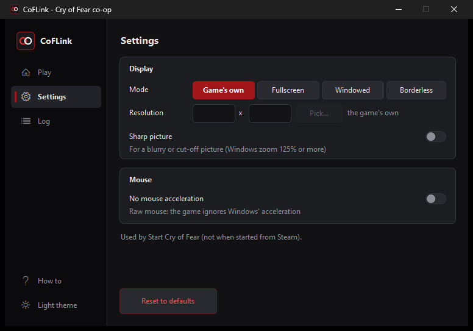
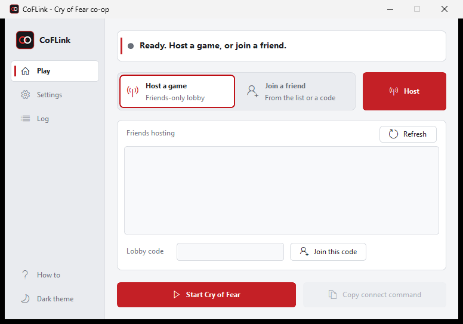

<div align="center">

# CoFLink

**Play Cry of Fear co-op with a Steam friend.**
No VPN. No port forwarding. No IP addresses.

[**Download the latest release**](../../releases/latest) · Windows · Free · MIT license

</div>

---

CoFLink carries Cry of Fear's LAN co-op through Steam's relay network, so you can play with Steam friends without Hamachi or Radmin. You don't install anything, and it doesn't need admin rights.

<p align="center">
  
</p>

## How to play

Both players unzip the [latest release](../../releases/latest) and open **CoFLink.exe**. Steam must be running, and the host must be your Steam friend. Up to 4 players.

**Host**
1. On **Play**, pick **Host a game** and click **Host**.
2. Click **Start Cry of Fear**, create a co-op game and choose **LAN**.
3. Keep CoFLink open while you play.

**Friend**
1. On **Play**, pick **Join a friend** and click **Join**. Then pick the host and click **Join** (or paste their lobby code).
2. When the host's game is up, click **Start Cry of Fear**.
3. In the main menu press `~`, then `Ctrl+V` and `Enter`. The connect command is already copied.

The **Settings** page picks fullscreen, windowed or borderless, the resolution, a sharp picture on zoomed (high-DPI) screens, and no mouse acceleration. **How to** in CoFLink walks you through each step. The full guide is [in the zip](package/README.txt).

<p align="center">
  
  
</p>

## Safety

- **Your IP stays private.** Traffic always goes through Valve's relay; direct connections are turned off.
- **Friends only.** The host only lets in its Steam friends, and can **Kick** anyone.
- **Nothing opened.** No ports on your PC or router; CoFLink only listens on `127.0.0.1`.
- **The game isn't modified.** Nothing is injected, and no files change.
- **Verified Steam DLL.** `steam_api.dll` is Valve's signed file, checked by SHA-256 before it loads.
- **Reproducible build.** The source always builds to the same file, so you can check the release against `SHA256SUMS.txt`.

Windows may warn about CoFLink because it is new and unsigned. As with any game server, only play with people you trust. To report a security problem, see [SECURITY.md](SECURITY.md).

## Building

```sh
sh build_windows.sh   # needs clang and lld -> build/win/CoFLink.exe
```

The tests in `test/` run on Linux with a mock Steam (see `test/run_tests.py`).

## Credits

The relay pattern comes from [Co-op Anything](https://github.com/cranebeaker/coop-anything). Cry of Fear is made by Team Psykskallar. CoFLink is not affiliated with them or with Valve. While CoFLink runs, Steam shows you as "playing Spacewar", Valve's free test app that it uses for lobbies.

CoFLink is [MIT licensed](LICENSE). `steam_api.dll` is Valve's, distributed under the Steamworks SDK terms.
